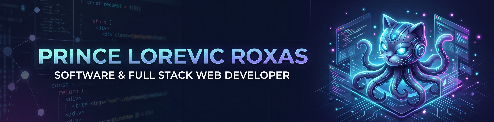

<!-- PALITAN ANG LINK SA IBABA NG TOTOONG URL NG UPLOADED BANNER MO -->

  <b>Building practical web applications and desktop software solutions.</b> 
  Clean Interfaces · Reliable Backends · Business Automation

 

---

## 👨‍💻 About Me

I'm a **Software & Full Stack Web Developer** focused on building applications that solve practical business problems, streamline workflows, and automate complex processes. My expertise bridges the gap between web platforms and desktop application integrations.

Whether it's developing a Learning Management System, architecting an HR Information System, or configuring desktop automation tools, I focus on building useful and maintainable systems.

- ⚛️ **Frontend:** Vanilla JavaScript, HTML5, CSS3, currently learning React
- ⚙️ **Backend & Software:** Node.js, Express.js, Basic Python, experience with Tauri & Rust
- 🗄️ **Database:** MySQL Workbench, Relational Database Design
- 📊 **Additional Tools:** Git, GitHub, VS Code, Figma, Canva, Looker Studio

---

## 🛠️ Tech Stack

### Frontend & Design

### Backend, Software & Database

### Tools & Workflow

---

## 🚀 Featured Projects

<table>
<tr>
<td width="50%" valign="top">

### 📦 Inventory Sales Management System
A comprehensive software solution for tracking inventory, managing product stock, and monitoring daily sales operations efficiently.

**Stack:** Node.js · Express.js · MySQL · JavaScript

<a href="https://github.com/princelorevic/Inventory-Sales-Management-System"><b>View Repository →</b></a>

</td>
<td width="50%" valign="top">

### 🏢 Human Resources Information System (HRIS)
A dedicated business system focused on organizing employee data, streamlining HR workflows, and structuring internal records.

**Stack:** Node.js · Express.js · MySQL · Vanilla JS

<a href="https://github.com/princelorevic/HRIS"><b>View Repository →</b></a>

</td>
</tr>
<tr>
<td width="50%" valign="top">

### 🎓 Enterprise Learning Management System
A web-based training platform designed to organize employee learning and track progress via interactive dashboards with role-based access.

**Stack:** Node.js · Express.js · MySQL · Looker Studio

<a href="https://github.com/princelorevic/Learning-Management-System-v.1"><b>View Repository →</b></a>

</td>
<td width="50%" valign="top">

### ⚙️ Offline Encoder Automation Software
A desktop application integration designed for process automation, featuring field normalization, local OCR capabilities, and Excel template mapping.

**Stack:** Tauri · Rust · Python FastAPI

 
<i>Internal/Private Business Application</i>

</td>
</tr>
</table>

---

## 📈 GitHub Stats

  
  

 

<i>Build with purpose. Learn continuously. Improve every day.</i>

